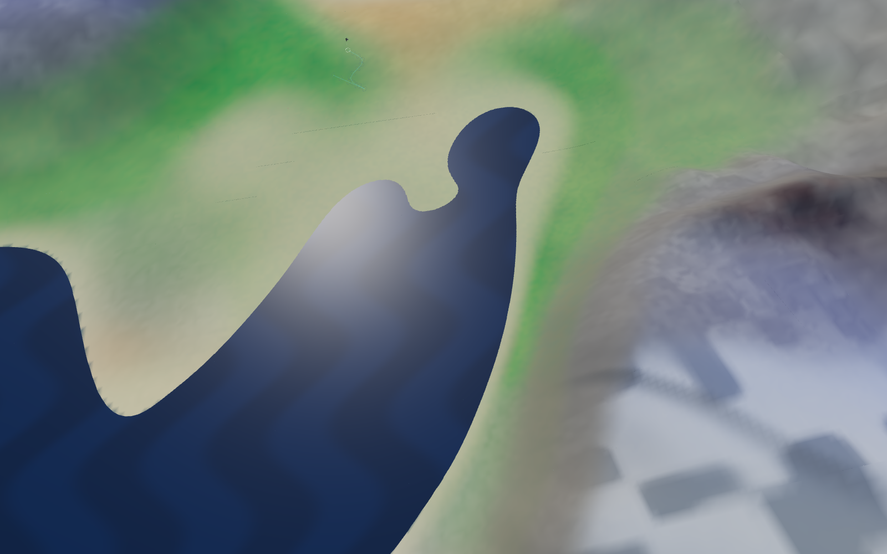

# Water review 11.045

## Far coast

Sea triangles now clip against the corrected drawn terrain bed, including vertices whose original biome was dry. Previously the coarse shore-bed correction could lower those vertices below sea level while the original binary biome mask still excluded their water. That mismatch cut cell-sized steps into the coast. Freshwater retains its river/basin mask; the direct water-builder compatibility path retains its previous default. Hydrology generation is unchanged.

Reproduction: `/dev/terrain.html?destination=ocean&seed=1`, with the review camera at `(-10904.482029513456, 9000, -16945.05757175386)`, looking at `(-11904.482029513456, 15, -11945.05757175386)`. This is the seed-1 regional sea, Clear weather, 1600 by 1000, pixel ratio 1. Both captures settled for 45 seconds and reported 554 loaded tiles, zero pending/in-flight/ready terrain jobs and four workers. The renderer was real Chrome with ANGLE/Vulkan on Intel Xe Graphics. These stills are visual evidence, not frame-performance measurements.

Before, `b9e1ac86`:


After:



Both images were inspected. The large steps at the left shore and the upper end of the inlet are removed. Coarse bank shading remains visible along the left edge. This does not certify all coasts or low-altitude transitions.

Run `scripts/review-water-coast.mjs before|after` with Node 22, `PLAYWRIGHT_MODULE`, `CHROMIUM_PATH` and optionally `REVIEW_URL` (default `http://127.0.0.1:5186`). Start Vite on that port with `--strictPort`. The script only exposes the existing development review camera through a browser response override; it adds no player UI. Destination, seed and settling time can be set with `REVIEW_DESTINATION`, `REVIEW_SEED`, and `REVIEW_SETTLE_MS`. Capture details are in the adjacent JSON files.

Validation: 52 checks across `waterCoarseCoast`, `waterSystem`, `waterMeshSteps`, `terrainGeometrySteps`, and `terrainWaterBed`, plus `npx tsc --noEmit`, pass on Node 22. Existing hash expectations are unchanged. The focused regression covers submerged formerly dry corners, the interpolated zero-height crossing, all-dry cells and preserved freshwater masks.

## Cold generation

No cold-generation optimization is retained. The largest sampled cost is water-river union work, followed by cold drainage channels/routing. Their algorithms are outside this branch's file ownership. A safe bounds/triangle rejection experiment in `WaterSystem.ts` preserved every sampled geometry digest, but did not demonstrate a reduction when measured in alternating pairs. Its seed-73 far work median/p95 was 202.02/290.06 ms before and 206.79/291.67 ms after; the water-river phase medians were 119.74 and 120.70 ms. The experiment was removed. Its exact patch and raw paired results remain in `cold-paired.json`.

### Method

Node v22.23.2, Intel Core i5-1135G7, on this machine. `profile-water-cold.mjs` collects independent empty-cache builds; `profile-water-cold-paired.mjs` alternates reference/candidate order AB then BA using two isolated module loaders in one process. Before each sample, a queried alternate seed clears hydrology and drainage caches, then the requested seed starts with an empty cache. No browser or tests were launched by this review during these studies. Normal host applications and the separately authorized water review could still vary host load. JIT remains warm across repetitions, so these are first-visit cache costs, not fresh-process startup distributions.

Each of the nine cases has 12 cold samples per side, including the first. Median averages the central pair; p95 uses nearest rank. Work is the sum of wall-clock durations of iterator `next()` calls. Largest slice is one `next()` call, including any scheduling interruption. Process CPU is Node's user plus system CPU during the build, including VM helper threads and instrumentation, so it can differ from elapsed work. Phase totals and all individual samples are retained in JSON. No frame or GPU result is inferred from these CPU measurements.

Reference is main `b9e1ac86`; retained candidate uses the coast correction `c4cf05bc`. Hydrology, near and far coordinates are respectively the same fixed point per seed: seed 1 `(-33600,-18480)`, seed 73 `(-8400,-20580)`, seed 1337 `(63840,34860)`. Hydrology builds one 32 km catchment. Near builds a 420 m LOD-0 tile; far builds a 3360 m LOD-2 tile, including any additional cold halo catchments and river unions. These are water-area fixtures, not an exhaustive search of the infinite world.

### Retained main/branch comparison

All times are milliseconds, median/p95. Every sampled hydrology digest and every sampled complete terrain/water buffer digest matches across the comparison. Existing test hashes were not edited.

| Seed / case | Main work | Branch work | Main process CPU | Branch process CPU | Main largest slice | Branch largest slice |
| --- | ---: | ---: | ---: | ---: | ---: | ---: |
| 1 / hydrology | 34.05/81.98 | 35.87/79.37 | 49.63/182.03 | 57.97/180.83 | 2.41/6.13 | 2.33/4.93 |
| 1 / near | 46.26/76.26 | 42.54/76.53 | 78.64/181.57 | 59.96/177.45 | 2.02/4.17 | 2.33/5.75 |
| 1 / far | 45.48/58.86 | 44.91/55.96 | 55.66/152.31 | 55.76/92.61 | 1.97/3.01 | 1.90/3.13 |
| 73 / hydrology | 49.80/74.00 | 49.30/66.12 | 65.83/138.77 | 58.19/110.52 | 1.80/3.37 | 1.88/2.50 |
| 73 / near | 103.64/162.06 | 102.57/186.89 | 147.72/307.57 | 114.50/318.93 | 7.35/16.57 | 7.64/17.44 |
| 73 / far | 259.53/492.91 | 237.84/619.36 | 339.44/521.86 | 284.52/601.79 | 3.89/17.79 | 3.74/15.38 |
| 1337 / hydrology | 137.18/264.57 | 181.86/302.84 | 88.72/190.47 | 88.39/348.46 | 10.55/14.50 | 11.26/53.07 |
| 1337 / near | 247.23/348.56 | 262.90/448.42 | 204.09/356.76 | 209.26/441.44 | 7.89/20.24 | 12.92/20.20 |
| 1337 / far | 251.39/460.26 | 234.27/261.81 | 233.09/316.46 | 228.52/403.73 | 8.63/17.12 | 5.45/13.29 |

These retained tiles do not hit the changed sea edge and their output/work is unchanged. Timing differences are noise, not an optimization. Unmodified seed-1337 hydrology itself shows large drift, and the 53.07 ms largest branch slice is retained. No hard slice deadline or speedup is claimed.

The retained branch's main phase medians: seed-73 far water-river 138.93 ms, hydrology channels 33.30 ms, shore/ground 27.80 ms and routing 11.62 ms. Seed-73 near climate sampling takes 31.36 ms, channels 32.84 ms, water-river 10.44 ms and the final slope/normal stage labelled skirt 7.64 ms. Seed-1337 far channels take 141.95 ms and routing 58.81 ms in the noisier final study. Pure catchment construction is unchanged: seed-1 channels/routing 19.35/11.28 ms, seed-73 32.70/10.97 ms, seed-1337 72.51/78.83 ms. The full phase breakdown and actual maxima remain in the raw data.

Reproduce with Node 22, with browser review and tests stopped:

```sh
node scripts/profile-water-cold.mjs --baseline=b9e1ac86 --samples=12 --output=/tmp/cold-main.json
node scripts/profile-water-cold-paired.mjs --baseline=b9e1ac86 --samples=12 --output=/tmp/cold-main-branch.json
```

`cold-main.json` is the initial separate main-only study. `cold-main-branch.json` is the retained paired comparison above. `cold-paired.json` records the discarded culling experiment against `c4cf05bc`, including its patch. The separate initial study's much slower numbers and the paired control drift are why no cold improvement is asserted.

Validation: 46 targeted water/terrain checks, both profiler syntax checks and `npx tsc --noEmit` pass. No safe, measured cold-cost reduction was found within owned files.

## Controlled foreground comparison

The sequential real-browser comparison and final full verification are pending.

The paused vegetation, flight-warning and blackout/redout systems remain excluded. No camera, mission, gate, scoring, featured-card, Free flight landing behavior or release metadata changes are included.
